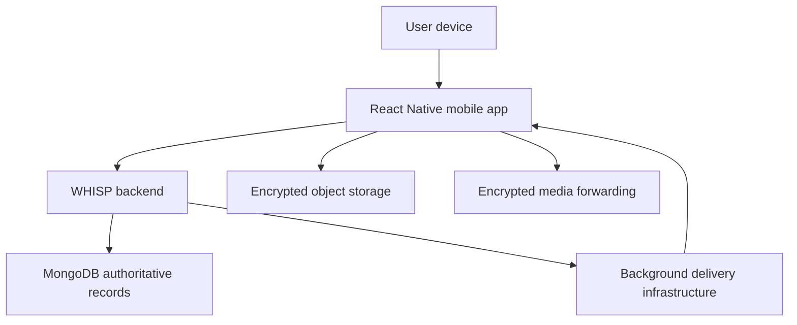
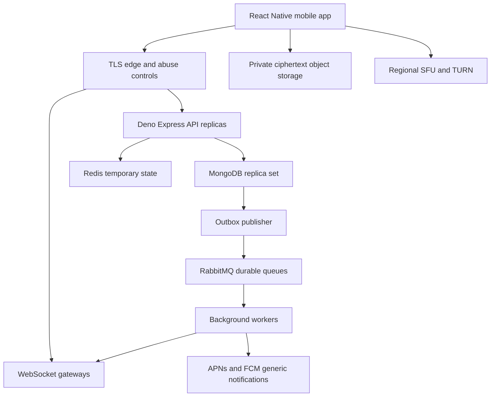
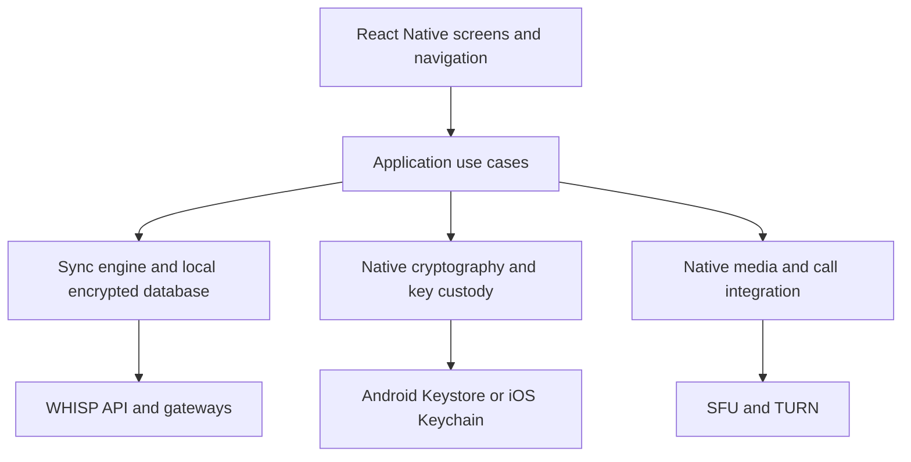
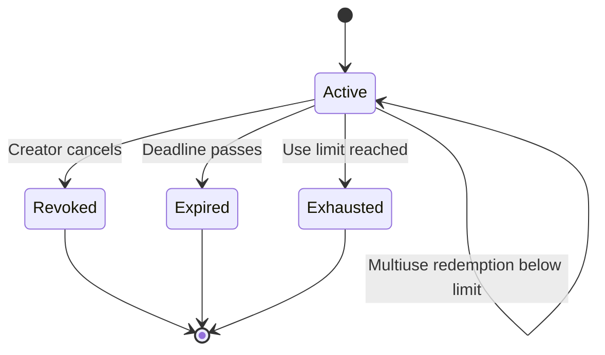
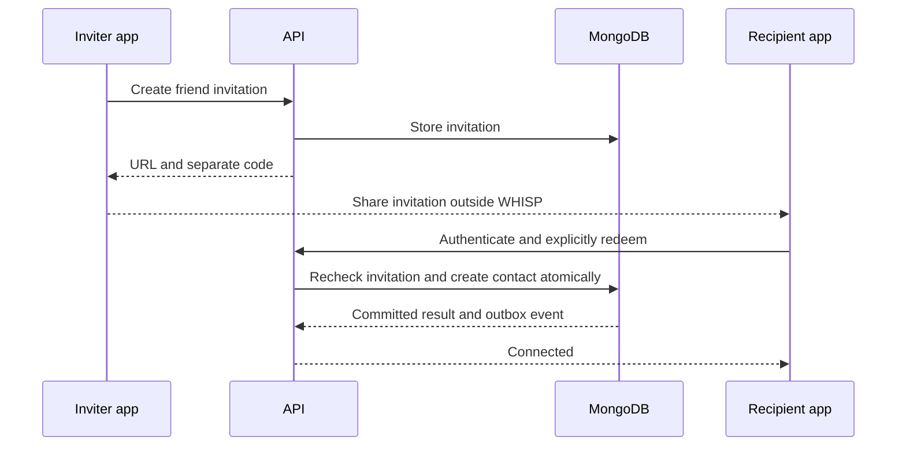
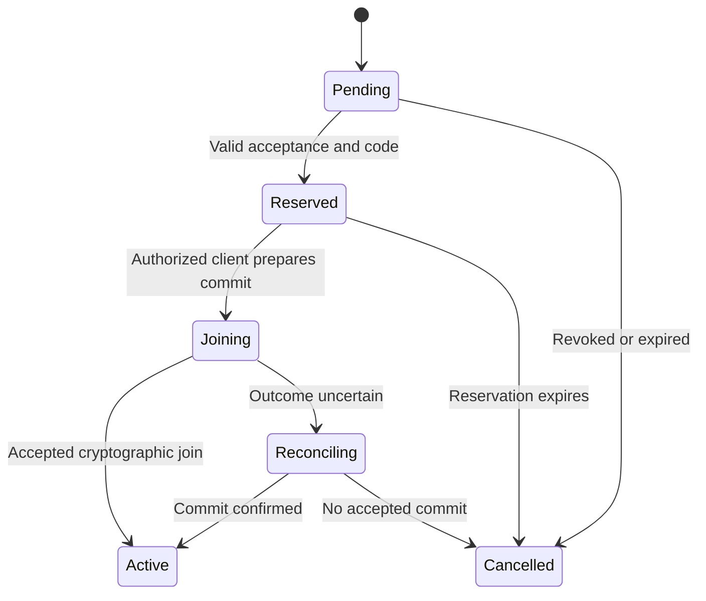
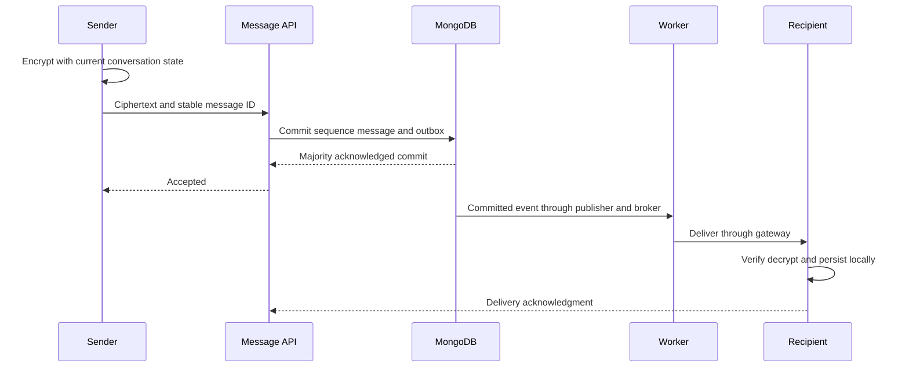

# WHISP Mobile Application Architecture Report

**Version:** 2.0  
**Date:** 21 October 2026  
**Status:** Proposed architecture for implementation planning  
**Revision:** Mobile scope supersedes the previous web-only report  
**Audience:** Product owner, beginner developers, engineering reviewers and security reviewers  
**Scope:** React Native mobile applications for Android and iOS. This report contains design specifications, not implementation code.

WHISP is a privacy-first, pseudonymous communication application. Users create a unique username and passkey, connect through controlled invitations, exchange end-to-end encrypted messages, participate in encrypted meetings, and store files in a personal encrypted vault. This report separates the system overview, high-level design and low-level design so the reader can understand the product before examining its mechanisms.

The architecture targets a staged beta reaching one million registered accounts. Capacity, security and mobile platform compatibility remain requirements to demonstrate through testing; they are not established properties of an unbuilt system.

## Reading guide

| Part | Purpose | Read it to understand |
|---|---|---|
| A System overview | Product and architectural decisions | What WHISP does and what it promises |
| B High level design | Components, boundaries and deployment | How the system fits together |
| C Low level design | Records, contracts, workflows and concurrency | How individual actions are managed |
| D Operational readiness | Capacity, failures and release gates | What evidence is needed before launch |
| E Reference material | Decisions, glossary and sources | Why choices were made |

## A System overview

### A1 Product requirements

| ID | Requirement | Planned behavior |
|---|---|---|
| FR01 | Passkey accounts | No email, phone number or account password required |
| FR02 | Unique usernames | User-selected or server-suggested; final claim is atomic |
| FR03 | Friend invitations | Shareable unique URL and separate secret code; recipient confirms |
| FR04 | Meeting invitations | Shareable unique URL and separate code; expiry, capacity and use policy enforced |
| FR05 | Group invitations | Direct invitation to an existing contact; acceptance and per-invitation code required |
| FR06 | Personal and group chat | Authorized devices encrypt and decrypt content |
| FR07 | Personal and conference calls | Application-level media encryption through forwarding servers |
| FR08 | Personal vault | Client encryption with separate vault keys and explicit recovery |
| FR09 | Offline use | Enrolled device unlocks downloaded content through locally protected keys |
| FR10 | Device management | Explicit linking, recovery and revocation |
| FR11 | Privacy controls | Blocking, invitation permissions, generic notifications and bounded retention |
| FR12 | Screen capture protection | Android capture restrictions and iOS capture responses with disclosed limits |

Public feeds, advertising, contact-book upload, federation, server-side transcription and automatic inspection of private content are outside this release.

### A2 Mobile scope and privacy constraints

**The product is a native mobile app built with React Native and TypeScript.** It targets Android and iOS with shared application logic plus native security, passkey, media and lifecycle integrations. A small HTTPS invitation landing page may explain installation and host domain-association files; it is not a web chat client.

**Screen capture protection differs by operating system.** Android secure-window controls can restrict screenshots and capture to non-secure displays. On iOS, supported capture-state APIs allow responses to detected recording or mirroring; ordinary screenshot notification arrives after capture. No supported general-purpose iOS mechanism is assumed to prevent every screenshot of arbitrary app UI. React Native does not eliminate this platform difference. External cameras, compromised devices and recipients who copy content remain outside this guarantee. [S10–S11]

**Offline unlock is not offline server authentication.** Device authentication can release a locally protected wrapping key and unlock cached data without contacting WHISP. New server login, username claims, invitation redemption and learning about revocation require a network.

**Pseudonymity is not complete anonymity.** No email, phone number or account password is required, but infrastructure sees IP addresses, timings, delivery destinations and some membership metadata. Push providers see device tokens and notification timing.

**Native encryption still trusts the endpoint.** Signed app releases reduce reliance on newly served web JavaScript but do not protect against a compromised release, operating system or unlocked device. Use native protected key storage, reviewed dependencies and restricted release access. Hardware protection depends on the device and key type; do not claim every key always resides in secure hardware.

**Store acceptance and OS behavior are deployment constraints.** Notification delivery, background execution, calls and capture behavior must be verified on the supported device matrix before public beta.

### A3 Technology baseline

| Layer | Decision | Explanation |
|---|---|---|
| Frontend | React Native and TypeScript | Shared Android and iOS UI, navigation and application logic |
| Mobile build | React Native native builds and Metro | Signed Android and iOS packages with native modules |
| Local persistence | Encrypted SQLite and private encrypted files proposed | Offline cache, outgoing work and manifests |
| Native secret storage | Android Keystore and iOS Keychain integrations | Protected wrapping keys and authentication-gated access |
| Backend language | TypeScript | Shared contract vocabulary; runtime validation still required |
| HTTP framework | Express | Routing, middleware and request handling |
| Backend runtime | Deno | Executes TypeScript and compatible Node/npm packages |
| Node ecosystem | Node-compatible APIs and packages | Node.js is not a second simultaneous production runtime |
| Database | MongoDB replica set | Authoritative application records and transactions |
| Ephemeral state | Redis proposed | Presence, rate counters and device-routing hints |
| Durable work broker | RabbitMQ quorum queues proposed | Background delivery, retry and cleanup work |
| Large files | Private object storage | Encrypted attachments and vault objects |
| Media | WebRTC with regional SFU and TURN | Real-time routing with an audited E2EE integration |

The requested “Node + TypeScript + Express + Deno” combination is interpreted as **Express on Deno using Node-compatible packages**. Deno documents this combination. Pin and test the MongoDB driver, WebSocket library, cryptographic libraries and observability dependencies; compatibility must be verified for the selected versions. CPU-heavy password verification and cryptography must not block the main request loop. [S1]

## B High level design

### B1 Architectural style

Use a modular monolith for account, invitation, contact, group and vault authorization. Modules have explicit ownership and interfaces but share one coordinated backend codebase. Deploy API processes, WebSocket gateways, background workers and media servers as separate workloads. This allows independent scaling without introducing dozens of network services prematurely.

### B2 System context and trust boundary

Plaintext and content encryption keys belong on authorized user devices. Backend systems authorize, store and forward ciphertext. TLS protects connections to infrastructure; end-to-end encryption additionally protects content from that infrastructure.

### B3 Logical container view

The outbox publisher polls committed MongoDB events and may use change streams as a wake-up optimization. Reconciliation scans remain necessary; a change stream alone is not the source of durable workflow truth.

### B4 Responsibility boundaries

| Module | Owns | Must not do |
|---|---|---|
| Identity | Accounts, passkey verification and sessions | Decrypt vaults on server login |
| Username | Normalization, suggestions and claims | Treat an availability check as a reservation |
| Device trust | Device public keys and signed trust changes | Authorize decryption solely from a server session |
| Invitations | Codes, expiry, usage and recipient binding | Use invitation codes as content keys |
| Contacts | Mutual connection state and blocks | Grant group membership implicitly |
| Conversations | Delivery authorization, sequence and membership coordination | Accept invalid client cryptographic commits |
| Messaging | Ciphertext acceptance and delivery cursors | Read message plaintext |
| Meetings | Admission, capacity, signaling and removal | Treat SFU access as decryption authority |
| Vault | Object quotas and encrypted manifest versions | Hold unwrapped vault master keys |
| Operations | Deployments, metrics, backups and incident handling | Log secrets or routine private content |

### B5 Deployment topology

Distribute signed Android and iOS releases through the chosen beta and production store channels. A small static HTTPS site hosts invitation landing pages, privacy information and app-domain association files. The main product runs in the installed app.

Route API and WebSocket traffic through a TLS edge. Keep MongoDB, Redis and RabbitMQ on private networks. Run APIs, gateways and workers across multiple availability zones in one primary write region. Place media pools near the beta audience. Use a secondary region for documented disaster recovery rather than unrestricted active-active writes.

Use container or equivalent managed hosting that supports Deno and long-lived connections. SFU/TURN hosting needs suitable UDP networking and bandwidth. APNs and FCM are external notification dependencies, not message-history databases.

### B6 Mobile application structure

| Layer | Responsibility | Main boundary |
|---|---|---|
| Screens and navigation | Onboarding, contacts, chat, groups, meetings, vault and settings | No direct secret persistence |
| Application use cases | Connect, send, join, upload, recover and revoke | Coordinates typed domain operations |
| Sync engine | Outgoing queue, cursors, retries and connectivity changes | Durable local work and server reconciliation |
| Crypto engine | MLS state, file encryption and authenticated key wrapping | Reviewed native libraries; minimal key exposure to JavaScript |
| Native security adapters | Passkeys, Keychain, Keystore, biometrics and screen protection | Platform-specific behavior |
| Media adapters | Camera, microphone, WebRTC and encrypted frame processing | Native real-time execution |
| Persistence adapters | Encrypted SQLite, private ciphertext files and protected secrets | Secrets separated from ordinary UI state |
| OS integration | Verified links, APNs/FCM, app lifecycle and call UI | OS permissions and background limits |

Use a native-enabled React Native setup with explicit control over security and media modules. A generic preview client is not the production validation environment. Keep UI state, server state and cryptographic state separate. Heavy encryption and media processing run in appropriate native workers rather than on the JavaScript UI thread. Do not assume a DOM, IndexedDB, service worker or browser Web Worker exists in React Native.

React Native guidance identifies ordinary AsyncStorage as unencrypted and unsuitable for sensitive secrets. Use it only for non-sensitive preferences. Store device wrapping material and refresh credentials through reviewed Keychain/Keystore integrations. Protect the local database key separately from the encrypted database. [S12]

### B7 Mobile background and notification model

Foreground apps use WebSockets for immediate events. Background or terminated apps receive generic push notifications where the OS permits. Push wakes or informs the app; the app then fetches authorized ciphertext and reconciles its cursor. Push payloads never include message plaintext, invitation codes or vault keys.

Background push delivery is not guaranteed. Do not depend on a permanently open socket or continuous JavaScript execution. The next permitted wake or foreground launch reconciles from durable history. Native calling integrations follow current iOS CallKit and applicable Android calling and foreground-service requirements; VoIP mechanisms must be used only for eligible calls. [S15]

Mobile lifecycle tradeoff: locking the personal vault must not accidentally end an explicitly active call. Keep call-session keys scoped to that call, while hiding chat and vault UI under the selected lock policy. Define the exact retained keys and clear them when the call ends.

## C Low level design

### C1 Core design principles

**Authoritative state** means the record the system trusts when copies disagree. MongoDB owns durable account, invitation and membership facts. Redis owns no irreversible permission decision.

**Atomicity** means an update completes as one indivisible operation. MongoDB single-document conditional updates are atomic. Multi-document invariants use transactions on a replica set with appropriate read and majority write concerns. Retry transient transaction failures and resolve uncertain outcomes using operation IDs. [S2]

**Idempotency** means repeating an operation has the same effect as completing it once. Every retryable mutation carries an operation ID scoped to its account and action. Reusing an ID with different request content is rejected. Store the committed result with the operation or business record.

**Eventual consistency** means secondary views can catch up later. Presence and notifications may lag. Username ownership, invitation usage and group admission rules require authoritative checks before success.

### C2 MongoDB collection model

Use separate collections for unbounded relationships and histories. Do not embed all contacts, messages, participants or redemptions in an ever-growing account or group document.

| Collection | Important fields | Required indexes or invariants |
|---|---|---|
| accounts | accountId, state, createdAt, securityVersion | Unique accountId |
| usernames | normalizedName, accountId, claimState | Unique normalizedName; one active name per account through a partial unique rule |
| credentials | credentialId, accountId, publicKey, status | Unique credentialId; account lookup |
| devices | deviceId, accountId, publicIdentity, trustVersion, state | Unique deviceId; account and state lookup |
| challenges | challengeId, sessionBinding, expiresAt, consumedAt | Unique challengeId; expiry cleanup |
| sessions | sessionId, refreshDigest, tokenFamilyId, accountId, deviceId, expiresAt, revokedAt | Unique refresh digest; account and device lookup; expiry cleanup |
| pushEndpoints | deviceId, provider, protectedToken, state, updatedAt | Unique provider and token identity; device lookup |
| invitations | invitationId, type, creatorId, recipientId, targetId, tokenDigest, codeVerifier, expiresAt, state, useLimit, usedCount, version | Unique invitationId; partial unique tokenDigest where present; recipient and target lookup |
| redemptions | invitationId, recipientId, operationId, result | Unique invitation and recipient pair; scoped operation uniqueness |
| contacts | lowerAccountId, higherAccountId, state | Unique canonical account pair |
| blocks | blockerId, blockedId, createdAt | Unique directed account pair |
| conversations | conversationId, type, latestSequence, acceptedEpoch, version | Unique conversationId |
| memberships | conversationId, accountId, role, state | Unique conversation and account pair |
| conversationDevices | conversationId, deviceId, membershipState | Unique conversation and device pair |
| messages | conversationId, sequence, senderDeviceId, clientMessageId, epoch, ciphertext, expiresAt | Unique conversation and sequence; unique conversation, sender device and client message ID |
| deviceCursors | deviceId, conversationId, lastDeliveredSequence | Unique device and conversation pair |
| meetings | meetingId, state, participantLimit, reservedSlots, activeSlots, version | Unique meetingId |
| admissions | meetingId, accountId, deviceId, state, leaseExpiresAt | Stable unique admission identity; meeting and state lookup |
| vaultManifests | accountId, manifestId, version, encryptedManifest, boundedObjectReferences | Unique account and manifest pair |
| objects | objectId, ownerId, purpose, size, uploadState, retentionState | Unique objectId; owner lookup |
| outbox | eventId, aggregateId, type, payload, state, nextAttemptAt, lease | Unique eventId; state and nextAttemptAt index |
| operations | accountId, action, operationId, requestDigest, result, expiresAt | Unique scoped operation identity |
| reports | reportId, reporterId, selectedEvidence, moderationState | Restricted moderator access; retention policy |

TTL indexes clean expired records asynchronously. Every security-sensitive request must compare expiry itself; an expired invitation or session may still physically exist until cleanup runs. Keep username tombstones outside short-lived cleanup rules. [S3]

Messages remain encrypted; indexes cover delivery metadata rather than plaintext content. Search within decrypted content is a client feature for this release.

### C3 Data structure selection

| Structure | WHISP application | Theory and limitation |
|---|---|---|
| Map | Gateway maps device IDs to sockets | Fast average lookup; local memory disappears on restart |
| Set | Unique active devices and bounded duplicate detection | Prevents repeated entries; persistent correctness still needs unique indexes |
| Indexed adjacency list | Contacts stored as account pairs | Retrieve neighbors efficiently without a graph database |
| Ordered log | Conversation sequences | Supports replay and gap detection; needs per-conversation coordination |
| Durable queue | Delivery and cleanup tasks | Buffers bursts; retries can repeat work |
| Scheduled work index | nextAttemptAt on jobs | Find due retries without one timer per task |
| Token bucket | Code attempts, invitation creation and message quotas | Permits short bursts while limiting sustained use |
| Bounded ring buffer | Media buffering | Keeps memory finite; stale media is discarded |
| Cryptographic tree | MLS group state | Protocol-defined group updates; use a reviewed library |

A queue does not make two MongoDB writes atomic. Indexes, transactions and version checks protect invariants. Queues handle deferred work and load smoothing.

### C4 Passkey authentication and mobile sessions

1. The app requests a short-lived registration challenge tied to its pending operation.
2. Validate the proposed username or generate suggestions without collecting personal details.
3. A native passkey adapter invokes Android Credential Manager or Apple AuthenticationServices.
4. The backend validates the response and atomically completes account, credential and username records.
5. Native cryptography generates separate device messaging keys and vault wrapping material.
6. Configure explicit recovery before encouraging important vault use.

For login, issue a fresh single-use challenge and validate the assertion, relying-party identity, allowed platform origin or app association, credential status and required user verification. The server stores public credential material; it never receives the passkey private key. Native Android and iOS association rules must be configured and tested rather than assuming the browser-origin rules apply unchanged. [S4, S13–S14]

The app obtains a short-lived access credential and rotating opaque refresh credential over TLS. Keep access material in memory where feasible and the refresh credential in protected native storage. Store only refresh digests server-side. Token families identify related rotations; a refresh replay revokes the family and requires fresh authentication. The client serializes refresh requests; the server uses conditional updates and a defined idempotent retry rule to distinguish response-loss retries from reuse attacks. Avoid infinite refresh loops.

API and gateway authorization checks session and device revocation. WebSocket handshakes use the chosen native library's authenticated mechanism without secrets in URLs. Long-lived connections revalidate or expire when access credentials expire. Authorization headers in a native client are not a browser cookie session; any optional website remains a separate security surface requiring its own browser controls.

Passkey authentication, device trust and local vault unlock remain distinct. A valid account session cannot silently enroll a new decrypting device.

### C5 Username claims

Suggestions are readable random candidates, filtered by policy and checked against current claims. A final unique-index insert decides ownership. If two accounts pick the same name, one receives a conflict and new suggestions. Renaming updates ownership in a transaction and preserves the immutable account ID used by contacts and invitations.

Avoid immediate recycling. Define a restricted initial character policy and case normalization to reduce confusing lookalikes. Do not make a public bulk username-enumeration endpoint merely because usernames exist.

### C6 Shared invitation lifecycle

Friend invitations default to one successful recipient. Meeting invitations may explicitly permit multiple recipients up to a configured usage limit; invitation uses and concurrent meeting capacity are separate limits. Group invitations are bound to one existing contact and require no public URL.

Generate unpredictable URL tokens and a separate high-entropy invitation code. Store a digest of the URL token and a password-hashed code verifier. Deliver the code once to the creator and avoid logging it. For friend and meeting invitations, the creator communicates it separately where practical. Group invitations must not contain their own plaintext code in the notification.

Validate account eligibility, code, expiry, state, usage and blocks. Then perform an authoritative transaction that rechecks relevant versions, records the redemption and applies the allowed business effect. Bounded code-verification workers and rate limits prevent expensive verification from exhausting the API. OWASP token guidance supports expiry, restricted use, secure generation and guessing protection; its adaptation here is a WHISP design choice. [S5]

Opening a link only displays a safe landing page. Redemption requires an explicit authenticated action. Use no-referrer policy, no third-party trackers, redacted access logs and immediate token removal from the visible browser address after safe handoff. Never embed the code in the URL.

### C7 Friend invitation workflow

The inviter consents by creating the invitation; the recipient consents by confirming. A canonical ordered account pair and unique index prevent duplicate contacts. A competing single-use redemption loses the conditional update. A lost response is resolved with the same operation ID. Self-invitation, blocked accounts and deleted inviters are rejected. Being connected authorizes future eligible interactions; it does not grant vault access or group membership.

### C8 Group invitation and encrypted membership

1. The inviter selects an existing contact.
2. Validate invitation permission according to the group role policy.
3. Create a recipient-bound invitation and an outbox event for its notification.
4. The recipient accepts and enters the separately shared code.
5. Reserve a membership slot in a transaction, rechecking group capacity, invitation state and authorization versions.
6. An authorized group client prepares the MLS membership change for the recipient device keys.
7. Accept one ordered membership commit for the expected epoch. Clients verify the cryptographic transition.
8. Activate membership only when the required encrypted join is established; deliver the corresponding Welcome to the joining device.

The database cannot atomically commit work inside another user's app. This is a durable multi-step workflow with leases and reconciliation. Do not release a slot blindly if a cryptographic commit might already have succeeded. If every authorized group client is offline, show pending secure admission rather than fabricating membership success.

MLS epochs are versions of the group's cryptographic state. Serialize conflicting membership commits per conversation and use a conditional expected-epoch update as the durable arbiter. Only the accepted commit's Welcome is processed. New members receive no automatic history. Removal changes future group keys; it cannot erase past content. [S6]

Code verification on the server is an admission gate, not proof against a malicious server. Signed invitation context, independently authenticated device rosters, visible membership changes, safety-code verification and a reviewed key-transparency design must bind cryptographic admission to the intended recipient. Full protection requires validating the integration, not merely selecting MLS.

### C9 Message acceptance and delivery

Authorization checks and the message write must coordinate with the authoritative conversation membership version. Membership-changing writes and sends use a common conversation sequencing/version mechanism so removal cannot race an unrelated stale permission read. Rejected stale epochs cause the sender to refresh group state and re-encrypt where required.

The transaction increments the conversation sequence, inserts the ciphertext message and inserts the outbox event. Unique client message identity makes a retry return the earlier result. This short per-conversation write path is deliberately serialized; different conversations proceed concurrently. Monitor unusually active groups for contention.

An outbox worker claims events with a time-limited lease and fencing/version check. It publishes to the broker with confirmation, then marks publication. A crash between those steps can publish a duplicate, so consumers deduplicate by event ID. Do not promise exactly-once transport. [S7]

Gateway delivery is retried and reconciled through persistent per-device cursors. An offline recipient retrieves authorized missing events after reconnecting. RabbitMQ tasks are not the permanent message history. A gateway write alone does not prove recipient delivery. Read receipts are optional and reveal metadata.

### C10 Meeting admission and media

The organizer creates a meeting with expiry, invitation policy, optional lobby and a default maximum of 25 participants. The recipient authenticates and enters the code. A transaction records a unique redemption and reserves capacity. Host approval, when enabled, precedes final admission.

An admission lease transitions from reserved to joining to active. A media callback cannot increment capacity twice: it references a stable admission identity. Count active devices explicitly, or enforce one active device per account for beta; this report chooses **one active meeting device per account**. Heartbeats renew active leases; reconciliation resolves dropped connections. A reconnect reuses an eligible admission rather than consuming a new invitation use.

Signaling handles connection negotiation and participant state. It is separate from the media transport. Use short-lived meeting-scoped SFU/TURN credentials. Clients encrypt encoded media before the SFU, using a reviewed SFrame integration and separately authenticated key distribution. Standard WebRTC transport encryption by itself does not establish content secrecy from a terminating SFU. [S8]

Relay personal calls by default to reduce participant-to-participant IP exposure. Test relay-only behavior; infrastructure still sees network addresses. Rotate media keys on joins and removals. Disable server recording and transcription. Fail closed when required E2EE support is unavailable. Do not place audio/video in the durable work queue; use bounded buffers and adaptive quality.

Meeting code possession does not prove a real-world identity. For sensitive meetings, enable host approval or recipient-bound invitations. Revoking a URL prevents new admissions; removing an already admitted participant is a separate action.

### C11 Vault and attachment lifecycle

Encrypt each file locally with a fresh file key using an authenticated encryption construction from a reviewed library. Protect file keys inside an encrypted manifest wrapped under the vault master key. Sensitive filenames and notes are encrypted. Nonce handling and chunk authentication belong to the reviewed cryptographic format, not an improvised scheme.

The API allocates a random object ID, reserves quota and grants short-lived upload permission. The client uploads ciphertext directly to private object storage and finalizes the upload. Verification checks expected object existence and size; it cannot establish plaintext safety or inspect content. Unfinished reservations and abandoned uploads are cleaned later.

Partition large vaults into bounded manifest documents, with an account-level root version and transactional updates where multiple manifests must change together. Do not allow manifests to exceed MongoDB document limits. Manifest updates carry an expected version. If two devices edit version 7, only one may commit version 8; the other must merge or resolve the conflict. Never silently overwrite. Object deletion first updates the authoritative manifest and retention state, then a worker deletes the object. Pending cleanup is observable and retryable.

Attachments follow the same encrypted object process, but their keys are shared inside the encrypted conversation rather than the personal vault. Display untrusted decrypted files in restricted native viewers; avoid executing active HTML or exposing native bridges to untrusted WebView content. Clear temporary plaintext files according to the lock and export policy.

### C12 Native key custody and offline unlock

| Key or secret | Holder | Recovery or loss consequence |
|---|---|---|
| Passkey private key | Platform authenticator or selected passkey provider | Account authentication recovery follows configured credentials |
| Device messaging keys | Protected native key material or encrypted private storage | New device requires explicit trust authorization |
| Device wrapping key | Keystore or Keychain-backed design with access controls | Device loss requires another trusted device or recovery secret |
| Vault master key | Wrapped for approved devices and recovery | Losing all wrappers and recovery material loses vault access |
| Per-file key | Encrypted manifest or encrypted conversation | Cannot decrypt without relevant content authority |
| Local database key | Protected separately from encrypted SQLite | Must not be stored beside the database in plaintext |
| Invitation code | Creator and intended recipient until redemption | Revoke and replace if leaked |
| Refresh credential | Reviewed native protected storage | Server revokes the session; credential cannot restore content keys |

Use a device-local wrapping design supported by the platform and gated by platform user verification. Do not derive vault keys from passkey signatures. Native biometric authentication is a local authorization gate; it is not itself a transferable encryption secret. Keep vault recovery independent of synced passkey availability. [S12–S14]

Offline unlock verifies the user locally, releases permitted device material, unwraps the local database or vault keys and decrypts cached data. Use a documented lock timeout, background privacy cover and explicit vault reauthentication. Some platform access-control choices require user presence and therefore prevent background decryption. Prefer fetching ciphertext in the background and decrypting after unlock rather than weakening key protection for previews.

Trusted-device linking uses a short-lived pairing transaction, a new device key, authenticated approval and encrypted transfer or wrapping for the new device. The approval binds the account, device public keys and transaction challenge. Recovery material must explicitly distinguish authority to restore account access from authority to restore encrypted data. If all authorized devices and recovery secrets are lost, encrypted data is unrecoverable.

Exclude unwrapped keys, refresh credentials and sensitive plaintext caches from ordinary OS backups. Define whether protected items migrate or remain device-only. Reinstall or backup restoration must not automatically activate a new trusted device. Biometric enrollment changes, device credential removal and key invalidation require a tested recovery path.

After reconnect, refresh device revocation and group epochs before sending queued content. Re-encrypt stale outgoing work where required. A revoked offline device may retain previously received content; remote revocation cannot erase that knowledge.

### C12a Screen protection lifecycle

Apply a common native screen-protection policy across all WHISP-owned windows, dialogs, attachment viewers, vault screens and call surfaces. It runs below the React component layer so navigation does not accidentally bypass it.

| Situation | Android design | iOS design |
|---|---|---|
| App content visible | Secure-window restrictions across supported surfaces | No universal screenshot-prevention claim |
| Background or app switcher | Obscure sensitive previews | Obscure sensitive previews |
| Recording or mirroring | Supported secure-display restrictions, tested per surface | Observe supported scene capture state and hide protected content |
| Screenshot notification | Detection is not a substitute for prevention | Notification is after capture; cannot retract the screenshot |
| External export | Explicit consent; destination leaves WHISP control | Explicit consent; destination leaves WHISP control |

Test camera/video surfaces, modals, external displays, accessibility and supported OS versions. Do not rely on undocumented secure-text-field workarounds for app-wide iOS guarantees. Rooted or jailbroken devices and external cameras can bypass the intended boundary. An active call requires an explicit capture-response policy for audio as well as video. [S10–S11]

### C12b Verified invitation links

Use HTTPS invitation links on a WHISP-controlled domain. Android App Links and iOS Universal Links associate that domain with the signed application. Configure Digital Asset Links and Apple association files; passkey associations and invitation-link associations are related deployment tasks with distinct service entries. [S13–S14, S16]

If installed, the OS opens the app and passes the opaque invitation token to a strict link parser. Accept only approved hosts, paths, token formats and bounded sizes. Treat every link as untrusted input. Store the pending invitation securely while onboarding or authentication completes, then ask for the separate code and explicit consent. Never redeem from navigation alone.

If the app is absent, show a minimal installation landing page without recipient or group secrets. Do not assume an app store preserves the invitation across installation; instruct the user to reopen the original URL afterward. Avoid third-party link analytics that would disclose invitation tokens. The fallback page cannot offer native screenshot protection.

### C13 Contract catalogue

These are conceptual interfaces, not executable routes or code. Every mutation requires runtime input validation, authentication, authorization, quotas and a bounded payload.

| Contract | Inputs | Success | Important failures |
|---|---|---|---|
| Begin and finish authentication | Challenge binding and WebAuthn response | Session | Replay, wrong origin, expired challenge |
| Suggest and claim username | Candidate or suggestion request | Committed claim | Conflict, invalid format |
| Create invitation | Type, target, recipient policy, expiry | Invitation and creator-visible code | Forbidden, quota exceeded |
| Redeem invitation | Token or invitation ID, code, operation ID | Connection or pending admission | Invalid, expired, blocked, exhausted |
| Revoke invitation | Invitation ID and expected version | Revoked | Unauthorized or conflicting state |
| Send ciphertext | Conversation, device, epoch, client ID, payload | Durable accepted ID and sequence | Stale epoch, removed member, oversize |
| Synchronize events | Conversation and authorized cursor | Bounded event page and next cursor | Access revoked, history no longer retained |
| Join meeting | Meeting admission identity | Pending or scoped authorization | Full, locked, E2EE unsupported |
| Begin and finalize object upload | Purpose, size, encrypted metadata | Scoped permission then object record | Quota, size mismatch, expired permission |
| Update vault manifest | Ciphertext and expected version | New version | Version conflict |
| Link or revoke device | Device keys, approvals and version | Updated trust state | Invalid approval, stale trust version |

Real-time events carry event ID, type, entity ID, version or sequence, and ciphertext or minimum necessary metadata. Clients tolerate duplicates and gaps. Reconnect uses random exponential backoff and cursor replay; timestamps alone do not define ordering.

### C14 Concurrency and consistency matrix

| Race or failure | Correctness mechanism | Recovery |
|---|---|---|
| Same username claimed twice | Unique normalized-name index | Loser chooses another name |
| Single-use invite redeemed twice | Conditional invitation update in transaction | Return prior operation or exhausted result |
| Contact creation repeated | Unique canonical pair | Return existing connection |
| Final group or meeting slot contested | Atomic capacity reservation and unique admission | Reject excess request |
| Permission revoked during acceptance | Expected authorization versions and coordinated writes | Refresh and re-evaluate |
| Two membership commits | Expected epoch and ordered commit acceptance | Rebase losing operation |
| Message accepted but response lost | Stable message identity and stored result | Return accepted sequence |
| Outbox publication repeated | Event-ID idempotency | Safe repeated processing |
| Worker pauses beyond lease | Fencing/version checks and idempotent effects | Current worker reconciles |
| Concurrent vault edit | Expected manifest version | Merge or explicit conflict |
| Expired session still in MongoDB | Request-time expiry check | Reject independently of TTL cleanup |

Never use an in-memory mutex as the only protection across API replicas. Redis locks may coordinate efficiency but do not replace MongoDB constraints for durable business invariants.

## D Operational readiness

### D1 Capacity assumptions

| Dimension | Initial planning value |
|---|---:|
| Registered accounts | 1,000,000 |
| Daily active accounts | 200,000 |
| Peak device connections | 75,000 |
| Logical messages per active account per day | 40 |
| Daily logical messages | 8,000,000 |
| Average logical rate | About 93 per second |
| Illustrative peak at 20 times average | About 1,850 per second |
| Peak media participants | 5,000 |
| Group limit | 250 accounts |
| Conference limit | 25 participants |

These assumptions need product validation. A logical message can generate many device deliveries. At a 2 KB envelope, logical message payload alone is about 16 GB daily before indexes, replication and attachments. At 1 Mbps received per media participant, 5,000 participants imply about 5 Gbps outbound media, or 2.25 TB per hour before overhead. Retention, fan-out and media quality drive cost more than account count alone.

### D2 Scaling approach

Scale stateless APIs by latency and request load, gateways by connections and outbound traffic, workers by queue age and throughput, and media servers by bandwidth and forwarding load. Bound per-connection buffers and worker concurrency. Drop expendable presence updates before durable messages. Apply admission control when downstream capacity is exhausted.

Start MongoDB with a properly sized replica set, measured indexes and retention. Do not shard merely because there are one million accounts. If messaging requires sharding, evaluate conversation locality and hot groups. MongoDB sharded unique indexes generally need the shard key as a prefix, which affects the uniqueness design. Keep the username registry unsharded initially; redesign and test message indexes together with a future shard key. [S9]

### D3 Queue policy

Separate delivery, notification and cleanup workloads so slow object cleanup cannot starve messaging. Use a fixed or measured number of conversation-hash partitions for work that benefits from locality; do not create a physical broker queue per user. Parallel consumers and redeliveries still require sequence and version checks.

Workers acknowledge only after the defined durable effect. Retry transient failures using exponential delay with jitter. Move repeatedly failing tasks to a restricted dead-letter queue with redacted metadata and an operator replay procedure. Monitor oldest task age, not only queue length. Presence can expire without recovery; durable accepted messages cannot depend on Redis survival.

### D4 Failure behavior

| Failure | Expected behavior |
|---|---|
| MongoDB majority unavailable | Reject authoritative mutations; do not acknowledge messages as durable |
| Redis unavailable | Presence degrades; strict rate-limited admissions fail closed or use a bounded authoritative fallback |
| RabbitMQ unavailable | Committed outbox retains work; delivery delayed; enforce backlog limits |
| Gateway fails | Clients reconnect elsewhere and replay missing events |
| Authorized group clients offline | Secure join remains pending |
| Object upload interrupted | Resume safely or expire reservation and remove abandoned ciphertext |
| SFU fails | Reconnect and renegotiate through another node; call disruption is visible |
| App data cleared or device lost | Recover through another trusted device or recovery kit |
| Region fails | Execute documented secondary-region restore with measured data-loss window |

### D5 Privacy and abuse management

Use generic notifications with no plaintext message previews by default. Minimize IP and diagnostic retention; never log invitation secrets, session credentials, plaintext messages or unwrapped keys. Redact URL tokens at the edge as well as in application logs.

Apply invitation quotas, recipient blocks, progressive limits for new accounts and per-account/device/invitation/network abuse controls. IP-only rules would unfairly group users behind shared networks. User reports disclose the exact selected evidence being sent to moderation; E2EE does not allow routine server-side inspection of conversations.

Document separate retention periods for accepted ciphertext, undelivered events, invitation metadata, expired credentials, object deletion and backups. A storage encryption key managed by the cloud protects infrastructure disks; it does not replace user-held end-to-end keys.

### D6 Observability and release controls

Track request latency, error rate, database contention, outbox age, broker backlog, reconnect storms, admission failures and media quality. Prefer aggregate metrics over high-cardinality user identifiers. Audit privileged administrative actions without capturing private content.

Use pinned dependencies, lockfiles, secret scanning, dependency review, least-privilege Deno permissions and protected app signing credentials. Distribute verified mobile releases with staged rollout and compatible schema migrations. If over-the-air JavaScript updates are adopted, authenticate their origin, restrict release authority, test native-version compatibility and treat the update channel as part of the encryption trust boundary. Avoid arbitrary remote code and unsafe embedded WebViews. Apply browser security headers to the limited invitation landing site.

### D7 Proposed objectives and release gates

| Objective | Initial target |
|---|---|
| Core account and messaging API availability | 99.95 percent monthly |
| Home-region message acceptance | p95 under 300 ms at agreed load |
| Healthy-network online delivery | p95 under 1 second |
| Regional core-service recovery | Within 60 minutes |
| Regional durable-data loss | Target at most 5 minutes for explicitly covered stores |

These targets require measured replication, backups, restore procedures and cost estimates. Multi-zone durability does not automatically provide the regional recovery target.

Release evidence must include username races, invitation double redemption, permission-revocation races, duplicate delivery, concurrent MLS commits, unauthorized device substitution attempts, meeting-capacity contention, interrupted vault updates, mobile platform compatibility and offline recovery. Exercise database failover, broker outage, queue replay, backup restore and region recovery. Independently review cryptography integration, native key custody and the recovery specification.

### D8 Delivery milestones

| Milestone | Demonstrable outcome | Exit evidence |
|---|---|---|
| 1 Identity | Username and passkey onboarding | Claim races, login replay and session revocation checked |
| 2 Invitations | Friend connection through URL and code | Preview safety, expiry and duplicate redemption checked |
| 3 Messaging | Encrypted personal messages and reconnect | Server cannot decrypt; retries and replay reconcile |
| 4 Groups | Recipient-bound invitations and encrypted joins | Epoch conflicts and member removal checked |
| 5 Vault | Encrypted upload, unlock and recovery | Concurrent edits and lost-device drill checked |
| 6 Meetings | Encrypted personal calls and conferences | Admission limits, relay privacy and E2EE matrix checked |
| 7 Beta operations | Controlled staged rollout | Load, recovery, security and cost gates passed |

## E Reference material

### E1 Architectural decision record

| Decision | Rationale | Consequence |
|---|---|---|
| React Native Android and iOS release | Current requested scope | Native platform adapters and signed app builds required |
| Platform-specific screen protection | Android and iOS expose different controls | Absolute screenshot blocking remains unavailable across both platforms |
| Express on Deno | Fits requested stack without two competing runtimes | Package compatibility gate required |
| MongoDB authoritative storage | Requested database with atomic operations and transactions | Explicit schema and index discipline required |
| Modular backend | Simpler coordination and operation initially | Extract services only after measured need |
| Transactional outbox | Avoid lost background work after committed mutations | Duplicate publication remains possible |
| Client-held encryption keys | Privacy-first content custody | Recovery must be designed before important data use |
| MLS messaging foundation | Standardized group state management | Audited implementation and application identity binding required |
| SFU with application media encryption | Scalable conferencing without media plaintext at relay | Native media and key-distribution compatibility gates |
| One primary write region | Simplifies uniqueness and membership ordering | Distant clients incur added control-plane latency |

### E2 Beginner glossary

| Term | Meaning in WHISP |
|---|---|
| HLD | High-level design: components, responsibilities, boundaries and deployment |
| LLD | Low-level design: records, interfaces, states and algorithms for individual processes |
| Replica set | MongoDB nodes maintaining replicated data with a primary and failover mechanism |
| Transaction | A set of database operations committed or rolled back together |
| Unique index | A database-enforced prohibition on duplicate indexed values |
| Optimistic concurrency | Accept an update only when its expected version is still current |
| Outbox | Database records describing committed work waiting for publication |
| Lease | Temporary ownership that must be renewed or safely reassigned |
| Fencing | A version token that prevents an outdated worker from committing effects |
| Fan-out | Delivering one logical event to multiple recipient devices |
| Backpressure | Slowing or rejecting work when downstream capacity is exhausted |
| E2EE | Encryption where authorized endpoint devices hold the content keys |
| MLS epoch | A version of a group's cryptographic state |
| SFU | Server that selectively forwards media streams |
| TURN | Relay helping media traverse restrictive networks |
| Native adapter | Reviewed module connecting TypeScript application logic to operating-system capabilities |

### E3 Sources and verification notes

Official sources were checked on 21 October 2026. They support platform and protocol facts; the particular WHISP module boundaries, collection model, limits and service objectives are proposed design decisions. No implementation or load test has been performed for this report. Version 2 replaces the web-only scope with React Native mobile architecture; the MongoDB backend model and privacy boundaries are retained and adapted.

- **S1 Deno and Express:** [Express tutorial](https://docs.deno.com/examples/express_tutorial/) and [Node compatibility](https://docs.deno.com/runtime/fundamentals/node/).
- **S2 MongoDB atomicity and transactions:** [Atomicity and transactions](https://www.mongodb.com/docs/manual/core/write-operations-atomicity/).
- **S3 MongoDB expiry:** [TTL indexes](https://www.mongodb.com/docs/manual/core/index-ttl/).
- **S4 Passkeys and PRF:** [W3C WebAuthn Level 3](https://www.w3.org/TR/webauthn-3/).
- **S5 Token protection:** [OWASP Forgot Password Cheat Sheet](https://cheatsheetseries.owasp.org/cheatsheets/Forgot_Password_Cheat_Sheet.html), adapted here for invitation tokens.
- **S6 MLS:** [RFC 9420](https://www.rfc-editor.org/info/rfc9420/) and [RFC 9750](https://www.rfc-editor.org/rfc/rfc9750.html).
- **S7 Broker reliability:** [RabbitMQ acknowledgments and confirms](https://www.rabbitmq.com/docs/confirms).
- **S8 Media encryption:** [RFC 9605 SFrame](https://www.rfc-editor.org/rfc/rfc9605.html).
- **S9 MongoDB sharded indexes:** [Shard key indexes](https://www.mongodb.com/docs/manual/core/sharding-shard-key-indexes/).
- **S10 Android capture controls:** [Secure sensitive activities](https://developer.android.com/security/fraud-prevention/activities).
- **S11 Apple screenshot notification:** [Screenshot notification](https://developer.apple.com/documentation/uikit/uiapplication/userdidtakescreenshotnotification).

- **S12 React Native secret storage:** [React Native security guidance](https://reactnative.dev/docs/security).
- **S13 Android native passkeys:** [Credential Manager prerequisites](https://developer.android.com/identity/credential-manager/prerequisites).
- **S14 Apple native passkeys:** [Supporting passkeys](https://developer.apple.com/documentation/authenticationservices/supporting-passkeys) and [Connecting to a service with passkeys](https://developer.apple.com/documentation/authenticationservices/connecting-to-a-service-with-passkeys).
- **S15 Background delivery:** [Apple background updates](https://developer.apple.com/documentation/usernotifications/pushing-background-updates-to-your-app).
- **S16 Android verified links:** [Verify App Links](https://developer.android.com/training/app-links/verify-applinks).

### E4 Decisions required before implementation

Confirm the supported Android and iOS device and authenticator matrix, reviewed MLS and media libraries, recovery authority model, retention periods, primary audience region, per-account quotas and abuse-report handling. These are release prerequisites rather than reasons to delay this architecture report. The next design review should begin with replacement-device recovery and secure group admission, because failures there can invalidate the privacy promise even when message encryption is correct.
