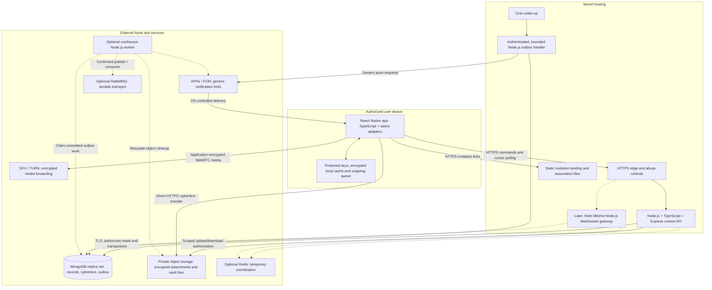

# ADR 001: Vercel control API and external durable services

Date: 22 October 2026  
Status: Accepted for implementation; no services deployed  
Ticket: [WHISP-001](../../tickets/01-foundation/WHISP-001.md)

## Decision and invariant

Run the HTTPS control API as **Node.js + TypeScript + Express on Vercel Functions**. TypeScript is the source language, Node.js executes the built code, Express handles HTTP requests, and Vercel supplies the hosting environment. Keep one modular backend codebase for identity, invitations, contacts, messaging, groups, vault authorization and meeting admission. Later job or gateway entry points reuse its domain rules rather than creating a competing backend.

The invariant is: **replacing any API instance must not lose an acknowledged durable mutation or grant decryption authority**. MongoDB owns authoritative records; authorized clients hold content encryption keys. In-memory state is disposable.

Node.js replaces production Deno for this deployment. There is no parallel Deno backend. Pin a supported Node version during [WHISP-002](../../tickets/01-foundation/WHISP-002.md) and prove the deployment during [WHISP-006](../../tickets/01-foundation/WHISP-006.md). Vercel documents Node.js as an official runtime and Express as a supported deployment framework. [Official runtimes](https://vercel.com/docs/functions/runtimes), [Express on Vercel](https://vercel.com/docs/frameworks/backend/express).

## Relationship to the architecture report

This decision takes precedence over the following deployment assumptions in the [architecture report](../../WHISP_Architecture_Report_HLD_LLD.md); the report remains the historical design baseline.

| Report section | Decision here |
|---|---|
| A2 — Mobile scope and privacy | Preserved: installed React Native Android/iOS apps, native security adapters, client-held content keys and disclosed OS limitations. The landing page is not a web chat client. |
| A3 — Technology baseline | Override Express-on-Deno with Express/TypeScript on Node.js. MongoDB and private object storage remain external. Redis and RabbitMQ become conditional additions. |
| B1 — Architectural style | Preserve one modular codebase and explicit ownership. API, optional gateways/jobs and media still have distinct execution boundaries. |
| B2 — Trust boundary | Preserve client-side encryption/decryption. Servers authorize, store and forward ciphertext; infrastructure TLS does not replace E2EE. |
| B3 — Logical container view | Replace the Deno API node with Vercel Node.js Functions. Start delivery with foreground polling and a durable MongoDB outbox; defer gateways and RabbitMQ. |
| B4 — Responsibility boundaries | Preserve module ownership: authorization and admission cannot substitute for cryptographic key possession. |
| B5 — Deployment topology | Override general Deno container hosting for the control API with Vercel. Keep data and media on external suitable hosts. Select API/database region and restricted network access during deployment; do not assume private networking or multi-zone/secondary-region recovery is already configured. |
| E1 — Architectural decisions | Replace only the Express-on-Deno decision; preserve modularity, MongoDB authority, transactional outbox, client-held keys and application-encrypted media. |

Related adaptations: B7's immediate foreground WebSockets become polling until [WHISP-068](../../tickets/09-delivery-and-background-work/WHISP-068.md) supplies project-specific evidence. C9/D3's continuous broker pipeline is deferred in favor of bounded outbox handling in [WHISP-065](../../tickets/09-delivery-and-background-work/WHISP-065.md)–[066](../../tickets/09-delivery-and-background-work/WHISP-066.md). D6's Deno-specific permission settings are replaced by least-privilege Node deployment credentials and network access; signing and release controls remain required. The report's scale, latency and recovery values remain unproven targets.

## Deployment map

Solid arrows show the intended baseline flows as their feature tickets are implemented. Dashed arrows show optional later services; this map does not assert that an application exists yet.

Meeting admission and short-lived SFU/TURN credentials come from the control API; media packets travel between devices and external media hosts. Attachment reservations and manifests come from the API; large file bodies travel directly to private object storage. This keeps file transfer within the intended platform boundaries. [Function limitations](https://vercel.com/docs/functions/limitations).

## Runtime, host, ownership and failure

“Durable-data owner” identifies the store or configuration authority that must survive a process restart. Provider selection, backups and retention still require later implementation.

| Component | Runtime / execution environment | Host category | Durable-data owner | Consequence of failure |
|---|---|---|---|---|
| Mobile app and native adapters | React Native JavaScript engine, TypeScript-built code and Android/iOS native modules | Installed signed app on user device | Client protected key storage, encrypted SQLite/private files and durable outgoing queue | Offline cache can remain usable under local unlock policy; server operations wait. Device loss needs trusted-device/recovery procedures. |
| HTTPS edge and static invitation site | Managed TLS routing and static file serving; no application runtime needed | Vercel edge/static hosting | Versioned landing/association assets and domain configuration | New requests or link verification fail; installed app data and external stores remain. |
| Control API | Node.js executing TypeScript-built Express handlers | Vercel Functions | External MongoDB for business state; deployment configuration for server credentials, never content keys | In-flight requests may fail or have an unknown outcome; retry with stable operation identity. No accepted work may rely on the lost heap. |
| MongoDB replica set | MongoDB database processes | External managed database or operated replica set | MongoDB: accounts, sessions/revocation, permissions, invitation usage, ciphertext, cursors, manifests, outbox/retry records | Without required majority, reject authoritative writes and do not acknowledge durability. Cached client content can remain available. |
| Private object storage | Provider object-service runtime | External private storage service | Object storage owns encrypted bytes; MongoDB owns reservations, quotas, manifests and cleanup state | Upload/download unavailable; reconcile interrupted transfers and retry cleanup. Do not claim a file is complete before the defined durable completion. |
| Scheduled outbox execution | Managed scheduler plus finite Node.js handler from the backend codebase | Vercel Cron and Functions initially; external scheduler possible | MongoDB outbox owns event IDs, leases/fencing, retry times and outcomes; deployment configuration owns scheduler credentials | Missed/failed runs delay effects. A later invocation reclaims eligible work and handles duplicates; no indefinite request-local consumer loop. |
| Notifications | APNs/FCM provider services and native OS delivery | External Apple/Google infrastructure | MongoDB owns device-token registrations and pending work; providers do not own message history | Hints may be delayed or lost. Authorized polling on the next permitted foreground/wake reconciles history. |
| SFU/TURN | Selected SFU and TURN server software with suitable UDP/bandwidth; implementation runtime remains to be selected | External media service, containers or VMs near users | MongoDB owns meeting admission; clients own media keys. Relay session state is disposable; deployment configuration owns relay credentials | Calls visibly interrupt and may need reconnect/renegotiation. Chat history survives. Relay access alone grants no decryption authority. |
| Optional WebSocket gateway | Node.js authenticated upgrade and connection handlers | Vercel Functions experiment, or external managed realtime/long-lived gateway | MongoDB owns replay history and authorization; connection/room maps are temporary | Disconnect and reauthenticate, resubscribe and replay from the durable cursor; reconnect may reach another instance. Polling remains available. |
| Optional Redis | Redis server/service | External shared ephemeral store | No authoritative business data; MongoDB remains permission authority | Presence/routing hints degrade. Strict admission limits fail closed or use a defined bounded authoritative fallback. |
| Optional RabbitMQ | RabbitMQ broker | External managed broker or suitable operated hosts | Broker owns confirmed durable transport; MongoDB outbox and idempotent consumers own workflow progress | Outbox retains unpublished work; confirmed queued work follows broker durability policy. Delivery can repeat and backlog must be bounded. |
| Optional continuous workers | Node.js worker entry points sharing backend domain modules | External managed worker/container/VM | MongoDB owns leases, retry/outcome state; broker owns queued transport if selected | Leases expire and another worker resumes with fencing/idempotency. A process-local queue cannot be the only work record. |

Content keys for messaging, vault/files and media remain on authorized devices, protected through reviewed native custody and authenticated key distribution/recovery. Backend, database, object-store, notification and relay operators receive no unwrapped content keys or routine plaintext. Server credentials and provider storage-at-rest encryption keys serve different purposes and do not grant E2EE content access.

## Delivery stages and unresolved costs

1. **Foreground baseline:** use bounded, authorized HTTPS cursor polling with retry/backoff. Commit ciphertext and required outbox work before acknowledging acceptance. A foreground recipient fetches authorized ciphertext, durably advances its local cursor after processing, and decrypts locally. Poll interval, page size, retention and latency need measurements in [WHISP-062](../../tickets/08-encrypted-messaging/WHISP-062.md) and [WHISP-067](../../tickets/09-delivery-and-background-work/WHISP-067.md). No continuous mobile background execution is assumed.
2. **Durable background effects:** WHISP-065–066 introduce an authenticated, bounded outbox drain. Persist leases, retry times, capped failures and reconciliation state in MongoDB. Cron is a wake-up, not a queue; failed invocations have no automatic retry and runs may overlap or repeat. [Cron management](https://vercel.com/docs/cron-jobs/manage-cron-jobs).
3. **Later realtime experiment:** WHISP-068 tests authenticated WebSockets with Fluid compute, forced closure/redeploy, authorization expiry, cross-instance coordination and replay. Current Vercel documentation supports WebSockets, but duration limits close connections. Choose it or an external transport only after project-specific evidence; connection memory cannot own membership or delivery truth. [Vercel WebSockets](https://vercel.com/docs/functions/websockets).
4. **External workers and media:** use an external continuous worker and optionally RabbitMQ when measured throughput, schedule latency or job duration warrants it. Select SFU/TURN hosting separately for networking and bandwidth, subject to native media E2EE gates in [WHISP-089](../../tickets/12-meetings/WHISP-089.md). These are deployment options, not services embedded in a function.

No paid plan or provider is selected. Resolve these costs before promising service levels:

| Area | Cost / capability still to measure or select |
|---|---|
| Polling and API | Requests per active device, compute, database connections, indexes, region latency and transfer |
| Background work | Schedule frequency, backlog age, handler duration and external scheduler/worker operating cost |
| Realtime | Connection occupancy, reconnect frequency, shared coordination and external provider charges |
| Durable storage | MongoDB replica set/backups, ciphertext retention, object requests/storage and transfer |
| Media | SFU capacity, TURN usage, regional bandwidth/egress and failover |

The currently documented Hobby cron schedule permits daily execution, which cannot promise prompt push or cleanup. Faster scheduling requires a suitable plan or external mechanism; choose and measure that in WHISP-066. [Cron usage and pricing](https://vercel.com/docs/cron-jobs/usage-and-pricing). Regional disaster recovery, one-million-user capacity and the report's SLOs remain unvalidated.

## Evidence and source comparison

The [WHISP-001 walkthrough and review notes](../validation/WHISP-001.md) record the happy path, instance-loss failure case, acceptance mapping and engineering-question answer. It is a documentation walkthrough, not a live MongoDB restart or Vercel deployment test.

Compared with [tickets/SOURCES.md](../../tickets/SOURCES.md) on 22 October 2026:

| Source entry | Agreement with this map |
|---|---|
| Vercel runtimes and Express | Supported Node.js control API; production Deno explicitly replaced |
| WebSocket support | Later finite-lifetime, externally coordinated experiment; no blanket claim that WebSockets are unsupported |
| Function limitations | Bounded handlers and direct ciphertext object transfers |
| Cron management and usage/pricing | Authenticated wake-up, persisted work/retries and plan-dependent cadence |
| Connection pooling and MongoDB Node driver | External database and bounded driver pools; a warm connection can be reused but cannot own business state |
| React Native security and native build references | Installed mobile app, protected local key custody and signed native builds |
| MongoDB transactions, MLS and SFrame | Preserve authoritative transactions and reviewed client cryptographic protocols; this decision selects no new crypto implementation |

The Vercel runtime, Express, WebSocket, function-limit and cron pages linked above were rechecked for this decision. Other entries preserve the repository's design constraints and still require their implementation tickets' verification.
